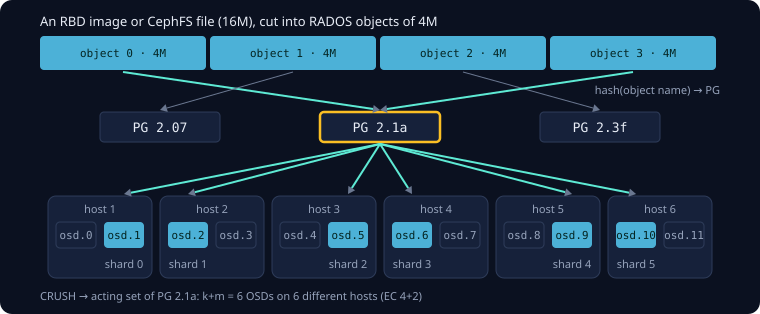
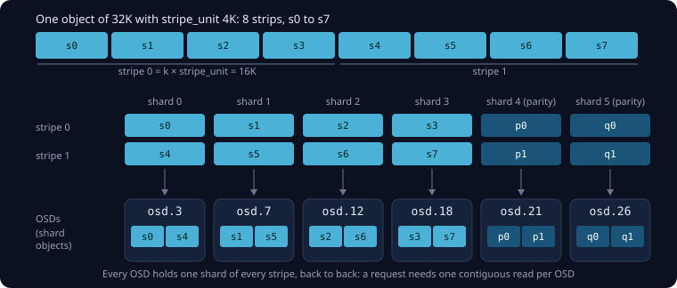
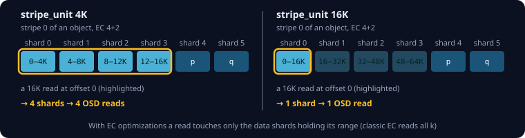
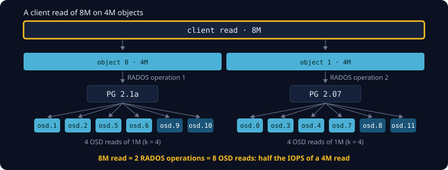

The calculator estimates IOPS by counting the OSD operations behind each client request. Those counts follow from
how Ceph stores data, so this page starts there: how data ends up in RADOS objects, placement groups and OSDs, and
how an erasure-coded (EC) pool splits each object into stripes and shards.

## From data to OSDs

Clients don't write to OSDs directly. RBD, CephFS and RGW cut an image, a file or a bucket object into **RADOS
objects** of a fixed size: 4M by default for RBD images and CephFS files (the object size in step 5 of the
calculator).

Every object belongs to a **placement group (PG)**, chosen by a hash of the object's name. **CRUSH** maps each PG to
an ordered set of OSDs, its *acting set*: `size` OSDs for a replicated pool, k+m OSDs for an EC pool, each in a
different failure domain (here: a different host). Everything Ceph stores for an object, its data and its parity,
lives on the OSDs of that one PG. The next object usually lands in another PG, and so on other OSDs.



## An object in an EC pool

An EC pool cuts each object into **stripes**. A stripe holds k **strips** of `stripe_unit` bytes (4K by default,
set in the EC profile, step 4) with consecutive data, plus m parity strips computed from them. The stripe width is
k × `stripe_unit`: 16K for EC 4+2 with a 4K `stripe_unit`.

Strip *i* of every stripe belongs to **shard** *i*, and shard *i* of all stripes of an object lives on the same OSD:
the *i*-th OSD of the PG's acting set. On that OSD the shard is stored as one object, with the strips of consecutive
stripes **back to back**.



The layout also explains what a request costs. A request needs some strips of some shards, and the strips it needs
from one shard are next to each other in that OSD's shard object. So **every OSD a request touches does one read or one
write**, however many strips the request covers on it. A 32K read of the object above reads `s0`+`s4` from the first
OSD, `s1`+`s5` from the second, and so on: four OSD reads of 8K each, not eight of 4K.

## Reading and writing

How many OSDs a client request involves depends on the pool layout and, for EC, on whether the pool has **EC
optimizations** (`allow_ec_optimizations`, Ceph Tentacle or later, step 4):

| Layout | Client read | Client write |
| --- | --- | --- |
| Replication, size n | 1 read (primary) | n writes |
| EC k+m | k reads (k+m with `fast_read`) | k reads + k+m writes |
| EC k+m, optimized | d reads | min(d+m, k−d) reads + d+m writes |
| EC, whole stripes | | k+m writes, no reads |

**Classic EC** works on whole stripes. A read fetches the stripe from all k data shards, even if the client wants
only 4K of it. A write to part of a stripe reads the k data shards, computes the new parity, and rewrites all k+m
shards (*read-modify-write*).

**With EC optimizations** a read touches only the data shards holding the requested range. A small write uses
*parity-delta* (read the d old data strips and the m parity strips, d+m reads) or *partial writes* (read the k−d
data strips it doesn't change), whichever reads less, and then writes the d changed data strips and the m parity
strips. `d` is the number of data shards a request touches:

```formula
d = ⌈request size ÷ stripe_unit⌉, at most k
```

The `stripe_unit` therefore decides how far a request spreads. With a 4K `stripe_unit` a 16K read covers four strips
on four shards; with a 16K `stripe_unit` it fits into one strip:



For an optimized EC 4+2 pool on 40 OSDs that each manage 1,000 random reads per second, the 16K reads come out as:

| `stripe_unit` | OSD reads per client read | Read IOPS |
| --- | --- | --- |
| 4K | 4 | 10,000 |
| 16K | 1 | 40,000 |

That is why Ceph recommends a `stripe_unit` of at least 16K with EC optimizations, and why the calculator recommends
raising it. Writes are different: a write covering whole stripes (a multiple of k × `stripe_unit`) needs no reads at
all, because all new parity can be computed from the new data. Small strips make more writes whole-stripe writes.

## Requests larger than an object

A RADOS operation always addresses exactly one object. A client request larger than the object size is split by
the client into one operation per object, and each object sits in its own PG, usually on other OSDs:



Each of those operations costs what the table above says. Requests in the calculator are aligned to their size, and
sizes are powers of two, so a request up to the object size stays inside one object, and a larger one covers whole
objects. With EC 4+2, a 4K `stripe_unit` and 40 OSDs at 1,000 IOPS:

| Client read | Objects | OSD reads | Read IOPS |
| --- | --- | --- | --- |
| 4M | 1 | 4 | 10,000 |
| 8M | 2 | 8 | 5,000 |

Each OSD read is 1M in both cases; the 8M read just needs twice as many.

## From OSD operations to IOPS

The calculator assumes the drives are the limit. You enter how many random reads and writes per second one OSD
sustains at the client I/O size (step 5). Every client operation keeps the OSDs busy for its reads and writes, and
CRUSH spreads the data, and with it the I/O, over the OSDs by capacity. The largest OSDs therefore get the most
requests and saturate first:

```formula
N_eff = capacity of all OSDs ÷ capacity of the largest OSD
IOPS  = N_eff ÷ (reads ÷ R + writes ÷ W)
```

`R` and `W` are the read and write IOPS of one OSD, `reads` and `writes` the OSD operations per client operation from
above. With equal OSDs, `N_eff` is simply the number of OSDs. For 12 equal OSDs at 200 read and 200 write IOPS and 4K
requests:

| Layout | Read | Write |
| --- | --- | --- |
| Replication 3x | 12 × 200 ÷ 1 = 2,400 | 12 ÷ (3 ÷ 200) = 800 |
| EC 4+2 | 12 × 200 ÷ 4 = 600 | 12 ÷ (4 ÷ 200 + 6 ÷ 200) = 240 |
| EC 4+2, optimized | 12 × 200 ÷ 1 = 2,400 | 12 ÷ (3 ÷ 200 + 3 ÷ 200) = 400 |

### Mixed device classes

A CRUSH rule restricted to a device class uses only those OSDs and their IOPS. A rule for any class spreads the I/O
over all classes by capacity, so each class's largest OSD saturates at its own rate, and the pool reaches its ceiling
when the first one does:

```formula
IOPS    = min over classes c of N_eff,c ÷ (reads ÷ R_c + writes ÷ W_c)
N_eff,c = capacity of all OSDs ÷ capacity of the largest OSD of class c
```

With 24 ssd OSDs of 8 TB and 16 hdd OSDs of 16 TB (448 TB), and 200 read IOPS per hdd, replication reaches
448 TB ÷ 16 TB × 200 = 5,600 read IOPS, however fast the ssds are. Slow OSDs limit the whole pool.

## What the estimate leaves out

The result is a ceiling for a healthy cluster with many parallel requests. It doesn't include:

- network bandwidth and latency, and the CPU of the OSD hosts;
- a single client that waits for each request (queue depth 1): it is limited by latency, not by these numbers;
- recovery, backfill and scrubbing, which compete for the same OSDs;
- how BlueStore lays out the data on the disk: one OSD read can take more than one disk access when an object is
  fragmented.

It also assumes:

- requests aligned to their size;
- per-OSD IOPS measured at the client I/O size (e.g. with fio against an OSD's device, or `ceph tell osd.N bench`
  for writes), so BlueStore overhead is included;
- shard operations smaller than the request (a 16K request on a 4K `stripe_unit` reads 4K per OSD) counting as full
  operations, which is slightly conservative.
